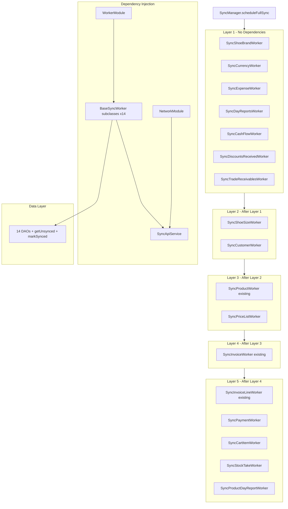
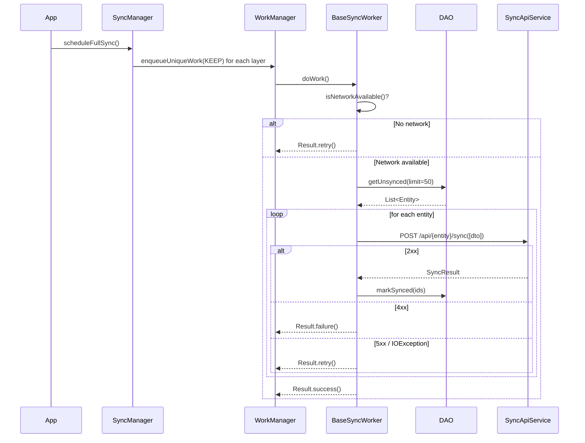
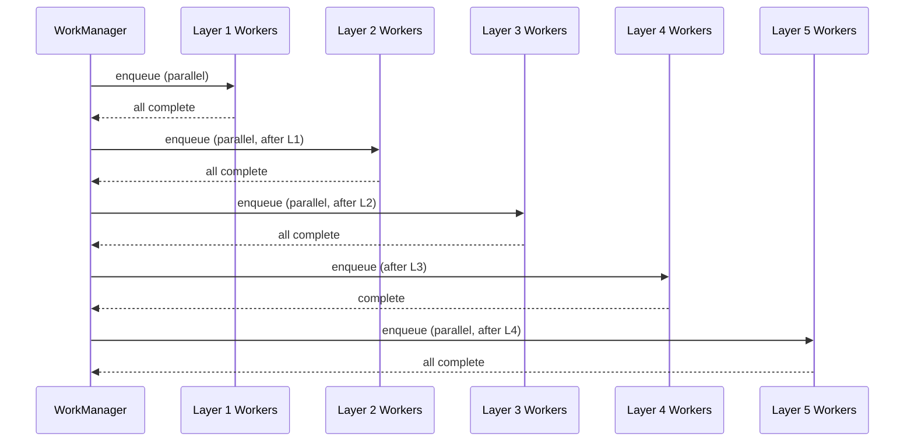

# Design Document: Entity Sync Workers

## Overview

This feature adds sync workers for the 14 Room entities that currently have an `isSynced` field but no corresponding WorkManager worker. It also introduces a `BaseSyncWorker` abstract class to eliminate the boilerplate duplicated across existing workers, a unified `SyncApiService` for all new sync endpoints, and replaces `SyncManager.syncAllNow()` with a DAG-ordered `scheduleFullSync()` that respects FK dependencies between entities.

The existing workers (Invoice, InvoiceLine, Product, User) are left structurally intact. New workers extend `BaseSyncWorker` and use `isSynced = 0` as the unsynced marker, while existing workers continue using `lastUpdated IS NULL`.

---

## Architecture



---

## Sequence Diagrams

### Full Sync Flow



### DAG Dependency Chain (WorkManager)



---

## Components and Interfaces

### BaseSyncWorker

**Purpose**: Abstract base that handles connectivity check, retry/backoff, batch loop, and error classification. Entity workers only implement three methods.

**Interface**:
```kotlin
abstract class BaseSyncWorker(
    context: Context,
    params: WorkerParameters,
    private val connectivityHelper: ConnectivityHelper
) : CoroutineWorker(context, params) {

    companion object {
        const val KEY_BATCH_SYNC = "batchSync"
        const val KEY_RETRY = "retry"
        const val BATCH_SIZE = 50
    }

    /** Fetch up to [limit] unsynced rows from the local DB */
    abstract suspend fun fetchUnsynced(limit: Int): List<*>

    /** Sync a single entity to the backend; return true on success */
    abstract suspend fun syncToApi(entity: Any): Boolean

    /** Mark the given entity as synced in the local DB */
    abstract suspend fun markSynced(entity: Any)

    override suspend fun doWork(): Result
}
```

**Responsibilities**:
- Check network before any DB/API work
- Drive the batch loop: fetch → sync → mark → repeat if more remain
- Classify errors: 4xx → failure, 5xx/IOException → retry
- Provide consistent logging via a TAG derived from the subclass name

### SyncApiService

**Purpose**: Single Retrofit interface for all 14 new batch-sync endpoints.

**Interface**:
```kotlin
interface SyncApiService {
    @POST("/api/customers/sync")
    suspend fun syncCustomers(@Body dtos: List<CustomerSyncDto>): Response<SyncResult>

    @POST("/api/expenses/sync")
    suspend fun syncExpenses(@Body dtos: List<ExpenseSyncDto>): Response<SyncResult>

    @POST("/api/shoebrands/sync")
    suspend fun syncShoeBrands(@Body dtos: List<ShoeBrandSyncDto>): Response<SyncResult>

    @POST("/api/shoesizes/sync")
    suspend fun syncShoeSizes(@Body dtos: List<ShoeSizeSyncDto>): Response<SyncResult>

    @POST("/api/currencies/sync")
    suspend fun syncCurrencies(@Body dtos: List<CurrencySyncDto>): Response<SyncResult>

    @POST("/api/payments/sync")
    suspend fun syncPayments(@Body dtos: List<PaymentSyncDto>): Response<SyncResult>

    @POST("/api/cartitems/sync")
    suspend fun syncCartItems(@Body dtos: List<CartItemSyncDto>): Response<SyncResult>

    @POST("/api/stocktakes/sync")
    suspend fun syncStockTakes(@Body dtos: List<StockTakeSyncDto>): Response<SyncResult>

    @POST("/api/tradereceivables/sync")
    suspend fun syncTradeReceivables(@Body dtos: List<TradeReceivablesSyncDto>): Response<SyncResult>

    @POST("/api/dayreports/sync")
    suspend fun syncDayReports(@Body dtos: List<DayReportsSyncDto>): Response<SyncResult>

    @POST("/api/productdayreports/sync")
    suspend fun syncProductDayReports(@Body dtos: List<ProductDayReportSyncDto>): Response<SyncResult>

    @POST("/api/cashflows/sync")
    suspend fun syncCashFlows(@Body dtos: List<CashFlowSyncDto>): Response<SyncResult>

    @POST("/api/discountsreceived/sync")
    suspend fun syncDiscountsReceived(@Body dtos: List<DiscountsReceivedSyncDto>): Response<SyncResult>

    @POST("/api/pricelists/sync")
    suspend fun syncPriceLists(@Body dtos: List<PriceListSyncDto>): Response<SyncResult>
}

data class SyncResult(val syncedCount: Int, val errors: List<String> = emptyList())
```

### Entity Sync Workers (×14)

**Purpose**: Thin subclasses of `BaseSyncWorker`, one per entity.

**Pattern** (example — SyncCustomerWorker):
```kotlin
@HiltWorker
class SyncCustomerWorker @AssistedInject constructor(
    @Assisted context: Context,
    @Assisted params: WorkerParameters,
    private val customerDao: CustomerDao,
    private val syncApiService: SyncApiService,
    connectivityHelper: ConnectivityHelper
) : BaseSyncWorker(context, params, connectivityHelper) {

    interface Factory : WorkerAssistedFactory<SyncCustomerWorker>

    override suspend fun fetchUnsynced(limit: Int) = customerDao.getUnsynced(limit)
    override suspend fun syncToApi(entity: Any): Boolean {
        val dto = (entity as Customer).toSyncDto()
        val response = syncApiService.syncCustomers(listOf(dto))
        return response.isSuccessful
    }
    override suspend fun markSynced(entity: Any) =
        customerDao.markSynced(listOf((entity as Customer).customerId))
}
```

### SyncManager (updated)

**Purpose**: Replaces `syncAllNow()` with `scheduleFullSync()` using a WorkManager DAG.

**Interface**:
```kotlin
@Singleton
class SyncManager @Inject constructor(private val workManager: WorkManager) {
    fun scheduleFullSync()          // DAG-ordered, KEEP policy
    fun scheduleSingleInvoiceSync(invoiceId: Long)
    fun scheduleSingleProductSync(productId: Long)
    fun scheduleInvoiceLineSync(invoiceLineId: Int)
    fun scheduleInvoiceBatchSync()
    fun scheduleProductBatchSync()
    fun scheduleInvoiceLineBatchSync()
}
```

---

## Data Models

### DAO Query Additions (×14 DAOs)

Each DAO gains two queries following this pattern:

```kotlin
// CustomerDao example
@Query("SELECT * FROM customer WHERE isSynced = 0 LIMIT :limit")
suspend fun getUnsynced(limit: Int): List<Customer>

@Query("UPDATE customer SET isSynced = 1 WHERE customerId IN (:ids)")
suspend fun markSynced(ids: List<Long>)
```

PK types vary per entity:

| Entity            | Table                  | PK field        | PK type |
|-------------------|------------------------|-----------------|---------|
| Customer          | customer               | customerId      | Long    |
| Expense           | expenses               | expenseId       | Long    |
| ShoeBrand         | shoeBrand              | brandID         | Long    |
| ShoeSize          | shoe_sizes             | shoeSizeId      | Long    |
| Currency          | currencies             | code            | String  |
| Payment           | payment                | paymentId       | Long    |
| CartItem          | cart_items             | cartItemId      | Long    |
| StockTake         | stock_take             | id              | Int     |
| TradeReceivables  | tradereceivables       | receivableId    | Long    |
| DayReports        | day_reports            | reportId        | Long    |
| ProductDayReport  | product_day_reports    | reportId        | Long    |
| CashFlow          | cashflow               | cashFlowId      | Long    |
| DiscountsReceived | discountsreceived      | discountId      | Long    |
| PriceList         | price_list             | priceListId     | Long    |

### Sync DTOs

Each entity has a corresponding `*SyncDto` data class mapping Room fields to the backend contract defined in `backend/Dtos/SyncDtos.cs`. DTOs are defined as extension functions `Entity.toSyncDto()` co-located in `SyncApiService.kt`.

---

## Algorithmic Pseudocode

### BaseSyncWorker.doWork()

```pascal
ALGORITHM doWork()
INPUT: WorkerParameters (KEY_BATCH_SYNC, KEY_RETRY)
OUTPUT: WorkManager Result (success | retry | failure)

BEGIN
  IF NOT connectivityHelper.isNetworkAvailable() THEN
    RETURN Result.retry()
  END IF

  isBatch ← inputData.getBoolean(KEY_BATCH_SYNC, false)
  shouldRetry ← inputData.getBoolean(KEY_RETRY, true)

  IF isBatch THEN
    RETURN performBatchSync(shouldRetry)
  ELSE
    RETURN Result.failure()  // entity workers override for single-item mode if needed
  END IF

  CATCH UnknownHostException | SocketTimeoutException | IOException →
    RETURN Result.retry()
  CATCH Exception →
    RETURN IF shouldRetry THEN Result.retry() ELSE Result.failure()
END
```

**Preconditions:**
- `connectivityHelper` is properly initialised
- Subclass has implemented `fetchUnsynced`, `syncToApi`, `markSynced`

**Postconditions:**
- Returns `Result.retry()` on transient network errors
- Returns `Result.failure()` on 4xx or unrecoverable errors
- Returns `Result.success()` when all fetched rows are processed

### performBatchSync()

```pascal
ALGORITHM performBatchSync(shouldRetry: Boolean)
INPUT: shouldRetry flag
OUTPUT: WorkManager Result

BEGIN
  entities ← fetchUnsynced(BATCH_SIZE)

  IF entities IS EMPTY THEN
    RETURN Result.success()
  END IF

  successCount ← 0

  FOR EACH entity IN entities DO
    -- Loop invariant: all previously processed entities are either synced or skipped
    ok ← syncToApi(entity)

    IF ok THEN
      markSynced(entity)
      successCount ← successCount + 1
    ELSE IF lastResponseCode IN [400..499] THEN
      LOG "Client error, skipping entity"
      -- continue to next entity; do not abort batch
    ELSE
      -- 5xx or network error
      RETURN IF shouldRetry THEN Result.retry() ELSE Result.failure()
    END IF
  END FOR

  RETURN Result.success()
END
```

**Preconditions:**
- `fetchUnsynced(limit)` returns at most `limit` rows with `isSynced = 0`

**Postconditions:**
- Every successfully synced entity has `isSynced = 1` in the local DB
- A 4xx on one entity does not abort the remaining entities in the batch
- A 5xx triggers retry of the entire batch

**Loop Invariants:**
- All entities processed before the current iteration are either marked synced or skipped
- `successCount` equals the number of entities for which `markSynced` was called

### scheduleFullSync() DAG Construction

```pascal
ALGORITHM scheduleFullSync()
INPUT: none
OUTPUT: WorkManager DAG enqueued with KEEP policy

BEGIN
  constraints ← Constraints(NETWORK_CONNECTED)
  backoff ← EXPONENTIAL, 15 minutes

  -- Layer 1: no FK dependencies
  layer1 ← [
    buildRequest(SyncShoeBrandWorker, constraints, backoff),
    buildRequest(SyncCurrencyWorker,  constraints, backoff),
    buildRequest(SyncExpenseWorker,   constraints, backoff),
    buildRequest(SyncDayReportsWorker,constraints, backoff),
    buildRequest(SyncCashFlowWorker,  constraints, backoff),
    buildRequest(SyncDiscountsReceivedWorker, constraints, backoff),
    buildRequest(SyncTradeReceivablesWorker,  constraints, backoff)
  ]

  -- Layer 2: ShoeBrand must complete before ShoeSize
  layer2 ← [
    buildRequest(SyncShoeSizeWorker,  constraints, backoff),
    buildRequest(SyncCustomerWorker,  constraints, backoff)
  ]

  -- Layer 3: ShoeSize + ShoeBrand must complete before Product; Product before PriceList
  layer3 ← [
    buildRequest(SyncProductWorker,   constraints, backoff),
    buildRequest(SyncPriceListWorker, constraints, backoff)
  ]

  -- Layer 4: Customer + Product must complete before Invoice
  layer4 ← [buildRequest(SyncInvoiceWorker, constraints, backoff)]

  -- Layer 5: Invoice must complete before Payment, CartItem, InvoiceLine, StockTake, ProductDayReport
  layer5 ← [
    buildRequest(SyncInvoiceLineWorker,     constraints, backoff),
    buildRequest(SyncPaymentWorker,         constraints, backoff),
    buildRequest(SyncCartItemWorker,        constraints, backoff),
    buildRequest(SyncStockTakeWorker,       constraints, backoff),
    buildRequest(SyncProductDayReportWorker,constraints, backoff)
  ]

  chain ← workManager
    .beginUniqueWork("full_sync", KEEP, layer1)
    .then(layer2)
    .then(layer3)
    .then(layer4)
    .then(layer5)

  chain.enqueue()
END
```

**Preconditions:**
- `WorkManager` is initialised and available
- All worker factories are bound in `WorkerModule`

**Postconditions:**
- If `full_sync` is already running, no duplicate chain is enqueued (`KEEP` policy)
- Each layer only starts after all workers in the previous layer have succeeded

---

## Key Functions with Formal Specifications

### BaseSyncWorker.fetchUnsynced()

```kotlin
abstract suspend fun fetchUnsynced(limit: Int): List<*>
```

**Preconditions:**
- `limit > 0`
- Room DB is open and accessible

**Postconditions:**
- Returns a list of at most `limit` entities where `isSynced = 0`
- Does not mutate any DB row

### BaseSyncWorker.markSynced()

```kotlin
abstract suspend fun markSynced(entity: Any)
```

**Preconditions:**
- `entity` was previously returned by `fetchUnsynced()`
- Entity PK is valid and exists in the DB

**Postconditions:**
- `isSynced = 1` for the given entity's row
- `getUnsynced()` will not return this entity in subsequent calls

### SyncManager.scheduleFullSync()

```kotlin
fun scheduleFullSync()
```

**Preconditions:**
- `WorkManager` is initialised

**Postconditions:**
- Exactly one `full_sync` chain is active at any time (KEEP policy)
- Workers in later layers have `prerequisiteWorkIds` pointing to all workers in the prior layer

---

## Error Handling

### Network Unavailable

**Condition**: `connectivityHelper.isNetworkAvailable()` returns false at worker start  
**Response**: `Result.retry()` — WorkManager will re-run with exponential backoff (15 min initial)  
**Recovery**: Automatic when network is restored

### 4xx Client Error

**Condition**: API returns HTTP 400–499 for a specific entity  
**Response**: Log the error, skip that entity, continue processing remaining entities in the batch  
**Recovery**: Manual intervention required (data validation issue); entity remains `isSynced = 0`

### 5xx Server Error / IOException

**Condition**: API returns HTTP 500+ or a network-level exception is thrown  
**Response**: `Result.retry()` — entire batch retried with exponential backoff  
**Recovery**: Automatic when server recovers

### Worker Failure Isolation

**Condition**: One entity worker in a layer fails permanently  
**Response**: WorkManager marks that worker as `FAILED`; sibling workers in the same layer are unaffected  
**Recovery**: Dependent layers (later layers) will not run for the failed chain, but independent chains are unaffected

### Duplicate Sync Prevention

**Condition**: `scheduleFullSync()` called while a `full_sync` chain is already running  
**Response**: `ExistingWorkPolicy.KEEP` — new enqueue request is silently dropped  
**Recovery**: N/A — existing run completes normally

---

## Correctness Properties

*A property is a characteristic or behavior that should hold true across all valid executions of a system — essentially, a formal statement about what the system should do. Properties serve as the bridge between human-readable specifications and machine-verifiable correctness guarantees.*

### Property 1: No-network always retries

*For any* Entity Worker instantiated with a `ConnectivityHelper` that reports no network, calling `doWork()` should return `Result.retry()` without invoking `fetchUnsynced`, `syncToApi`, or `markSynced`.

**Validates: Requirements 1.2, 7.1**

---

### Property 2: Successful batch marks all entities synced

*For any* non-empty list of entities where every `syncToApi` call returns HTTP 2xx, after `doWork()` completes, `markSynced` should have been called exactly once for each entity in the list and `doWork()` should return `Result.success()`.

**Validates: Requirements 1.5, 1.8**

---

### Property 3: 4xx skips entity but does not abort batch

*For any* batch of N entities where exactly one entity returns HTTP 4xx and the rest return HTTP 2xx, after `doWork()` completes, `markSynced` should have been called for all N-1 successful entities, the failing entity should remain `isSynced = 0`, and `doWork()` should return `Result.success()`.

**Validates: Requirements 1.6, 7.3**

---

### Property 4: 5xx retries entire batch

*For any* batch where any entity returns HTTP 5xx, `doWork()` should return `Result.retry()` and `markSynced` should not have been called for any entity in that batch.

**Validates: Requirements 1.7, 7.4**

---

### Property 5: getUnsynced never returns already-synced rows

*For any* database state, `getUnsynced(limit)` should return only entities where `isSynced = 0`, and the result list should contain at most `limit` entries.

**Validates: Requirements 2.1, 2.3**

---

### Property 6: markSynced is idempotent and precise

*For any* set of entity IDs, calling `markSynced(ids)` once or twice produces the same database state: exactly those rows have `isSynced = 1`, and all other rows are unchanged.

**Validates: Requirements 2.2, 2.4**

---

### Property 7: DTO round-trip preserves entity data

*For any* valid Room entity instance, converting it to a `SyncDto` via `toSyncDto()` and then serializing/deserializing the DTO to/from JSON should produce a `SyncDto` with field values equivalent to the original entity's mapped fields.

**Validates: Requirements 3.2, 4.2, 4.4**

---

### Property 8: KEEP policy prevents duplicate sync chains

*For any* number N ≥ 2 of consecutive `scheduleFullSync()` calls while a `full_sync` chain is already active, WorkManager should have exactly one active `full_sync` chain at any point in time.

**Validates: Requirements 6.2, 7.5**

---

### Property 9: DAG layer ordering is respected

*For any* two workers W_parent (in layer L) and W_child (in layer L+1), W_child's `prerequisiteWorkIds` should contain W_parent's work ID, ensuring W_child cannot start before W_parent completes.

**Validates: Requirements 6.3**

---

## Testing Strategy

### Unit Testing Approach

Test each worker in isolation by providing a fake DAO and fake API service:
- Verify `Result.retry()` when network is unavailable
- Verify `Result.success()` when all entities sync successfully
- Verify `markSynced()` is called for each successfully synced entity
- Verify 4xx does not abort the batch (remaining entities still processed)
- Verify 5xx returns `Result.retry()`

### Property-Based Testing Approach

**Property Test Library**: `kotest-property` (Kotlin-native, integrates with JUnit5)

Properties to verify:

1. **Completeness**: For any list of entities with `isSynced = 0`, after a successful batch sync run, `getUnsynced()` returns an empty list.

2. **Idempotency of markSynced**: Calling `markSynced(ids)` twice for the same IDs produces the same DB state as calling it once.

3. **No false positives**: `getUnsynced()` never returns an entity that already has `isSynced = 1`.

4. **DAG ordering**: For any two workers W_parent and W_child where W_child depends on W_parent, W_child's `prerequisiteWorkIds` contains W_parent's work ID.

5. **KEEP deduplication**: Calling `scheduleFullSync()` N times while the chain is running results in exactly 1 active `full_sync` chain.

6. **Batch completeness**: If `fetchUnsynced(50)` returns 50 rows, the worker re-runs (or re-fetches) until `fetchUnsynced(50)` returns an empty list.

### Integration Testing Approach

Use a Room in-memory database and a MockWebServer (OkHttp) to test the full path:
- Seed DB with N unsynced entities
- Run the worker via `TestListenableWorkerBuilder`
- Assert all rows have `isSynced = 1` after success
- Assert rows remain `isSynced = 0` after a simulated 5xx response

---

## Performance Considerations

- Batch size of 50 rows per worker run balances memory usage against round-trip overhead.
- Workers run on `Dispatchers.IO` — no main thread blocking.
- DAG layers run in parallel within each layer, maximising throughput while respecting FK constraints.
- `KEEP` policy prevents redundant work when the user triggers sync multiple times in quick succession.
- `getUnsynced(limit)` uses a `LIMIT` clause to avoid loading the entire table into memory.

---

## Security Considerations

- All sync calls go over the existing Retrofit client which enforces 60s timeouts and `retryOnConnectionFailure`.
- No credentials are stored in `WorkerParameters` (input data is not encrypted at rest on Android).
- DTOs must not include fields that expose internal device state beyond `deviceId` / `deviceName` already used by existing workers.

---

## Dependencies

| Dependency | Purpose |
|---|---|
| `androidx.work:work-runtime-ktx` | WorkManager coroutine workers |
| `androidx.hilt:hilt-work` | `@HiltWorker` / `WorkerAssistedFactory` |
| `com.squareup.retrofit2:retrofit` | HTTP client for sync endpoints |
| `com.squareup.retrofit2:converter-gson` | JSON serialisation |
| `io.kotest:kotest-property` | Property-based testing |
| `com.squareup.okhttp3:mockwebserver` | Integration test HTTP server |

### Files to Create

| File | Description |
|---|---|
| `network/BaseSyncWorker.kt` | Abstract base worker |
| `network/SyncApiService.kt` | Unified Retrofit interface + DTOs + `SyncResult` |
| `network/SyncCustomerWorker.kt` | Customer sync worker |
| `network/SyncExpenseWorker.kt` | Expense sync worker |
| `network/SyncShoeBrandWorker.kt` | ShoeBrand sync worker |
| `network/SyncShoeSizeWorker.kt` | ShoeSize sync worker |
| `network/SyncCurrencyWorker.kt` | Currency sync worker |
| `network/SyncPaymentWorker.kt` | Payment sync worker |
| `network/SyncCartItemWorker.kt` | CartItem sync worker |
| `network/SyncStockTakeWorker.kt` | StockTake sync worker |
| `network/SyncTradeReceivablesWorker.kt` | TradeReceivables sync worker |
| `network/SyncDayReportsWorker.kt` | DayReports sync worker |
| `network/SyncProductDayReportWorker.kt` | ProductDayReport sync worker |
| `network/SyncCashFlowWorker.kt` | CashFlow sync worker |
| `network/SyncDiscountsReceivedWorker.kt` | DiscountsReceived sync worker |
| `network/SyncPriceListWorker.kt` | PriceList sync worker |

### Files to Modify

| File | Change |
|---|---|
| 14 DAO files | Add `getUnsynced(limit)` + `markSynced(ids)` |
| `SyncManager.kt` | Add `scheduleFullSync()`, keep existing methods |
| `NetworkModule.kt` | Add `@Provides fun provideSyncApiService(...)` |
| `WorkerModule.kt` | Add `@Binds` for 14 new worker factories |
